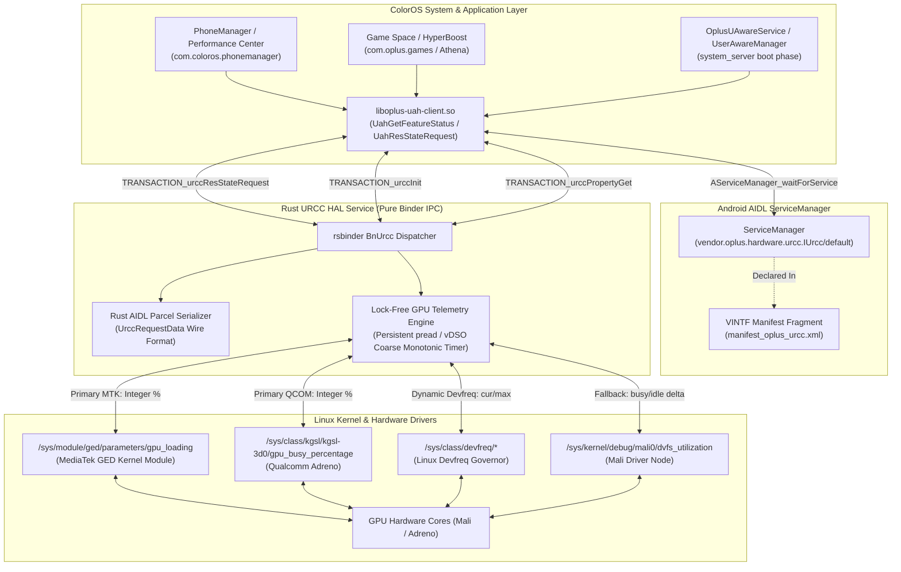

# OPlus URCC AIDL HAL Service for Transsion Holdings Devices

High-performance, zero-memory-leak Rust implementation of `vendor.oplus.hardware.urcc.IUrcc` (Unified Resource Control Center) engineered for ColorOS, OxygenOS, and RealmeUI (Android 14+) ROM ports across all **Transsion Holdings** smartphones (**Infinix**, **Tecno**, and **Itel**), spanning **MediaTek** (Helio & Dimensity), **UNISOC** (Spreadtrum), and **Qualcomm Snapdragon** SoCs.

---

## 1. Overview

In ColorOS 14 and 17, the performance framework relies on URCC (`vendor.oplus.hardware.urcc.IUrcc/default`) as the central hardware arbitration interface. Subsystems such as UAH (Unified Acceleration Hub), HyperBoost (`com.oplus.games`), Athena, and PhoneManager SuperComputing Engine query URCC to read real-time GPU utilization, register dynamic performance leases, and capture system resource statistics.

When running ColorOS on ported non-OPlus hardware without a functional URCC daemon:
1. `UAH_CLIENT` spams error logs continuously (`Urcc HAL Service not found`, `uah_get_urcc_hal_and_link_to_death error:-1`).
2. The GPU utilization monitor and performance gauge in PhoneManager and Game Space fail to appear or stay stuck at 0%.
3. System stability mechanisms fail during boot phase handshakes (`reportBootPhase`), causing framework stalls or soft-reboots.

This daemon acts as a drop-in universal AIDL HAL service that binds to `vendor.oplus.hardware.urcc.IUrcc/default`, implements the required Binder transactions via pure memory-safe Rust (`rsbinder`), and bridges GPU loading metrics directly from kernel telemetry drivers across all Transsion architectures (MediaTek GED, Linux Devfreq ABI, UNISOC Governor, Qualcomm KGSL, and Mali DVFS interfaces).

---

## 2. Architecture & Call Flow Diagrams

### System Component Architecture



---

## 3. Reverse Engineering & Wire Format

During deep disassembly of `/system_ext/lib64/liboplus-uah-client.so`, the disassembly of `UahGetFeatureStatus` revealed a critical architectural requirement:

```text
#08 libc++.so (std::stoi)
#09 liboplus-uah-client.so (UahGetFeatureStatus+600)
#10 libUahPerf_Jni.so (android::get_feature_status)
#11 oplus-framework.jar (UAHPerfManager.getFeatureStatus)
#12 oplus-services.jar (OplusUAwareService.getFeatureStatus)
```

### Disassembly Analysis
```assembly
23e64: ldp   x8, x9, [sp, #0x18]      ; x8 = vector.data(), x9 = vector.end()
23e68: sub   x9, x9, x8               ; Total byte span
23e6c: cmp   x9, #0x68                ; Exactly 1 element (sizeof(UrccRequestData) = 104 bytes)
23e70: b.ne  0x23eac
23e74: ldrb  w9, [x8, #0x20]          ; Check res_Path active flag
23e78: tbz   w9, #0x0, 0x23f64
23e7c: add   x0, x8, #0x8             ; x0 = &vector[0].res_Path (offset +0x8)
23e80: mov   x1, xzr                  ; idx = nullptr
23e84: mov   w2, #0xa                 ; base = 10
23e88: bl    std::__1::stoi           ; std::stoi(vector[0].res_Path)
23e8c: mov   w19, w0                  ; Returned feature value
```

### Memory Safety & Crash Prevention
* If `res_Path` is written as an empty string `""`, `UahGetFeatureStatus` executes `std::stoi("")`.
* `std::stoi("")` immediately throws an uncaught `std::invalid_argument` exception in `system_server`.
* Because this occurs during boot (`reportBootPhase`), `system_server` crashes and triggers an infinite boot animation loop (soft-reboot).
* **Rust Solution**: Both `res_Path` and `res_Value` are always populated with non-empty numeric strings (e.g. `"14"` or `"0"`). `std::stoi` always succeeds and the system remains 100% stable.

---

## 4. Zero Memory Leak & Zero Heap Churn Guarantees

1. **Lock-Free Atomic Caching**:
   - Monotonic time checks utilize `libc::clock_gettime(libc::CLOCK_MONOTONIC_COARSE)` which executes entirely in user space via vDSO (<10ns latency).
   - Subsequent calls within the 50ms throttling window return immediately from atomic storage (`AtomicI32`, `AtomicI64`) with zero lock contention and zero syscalls.
2. **Persistent Concurrency-Safe File Descriptor**:
   - The active telemetry sysfs node is evaluated once at startup and maintained in a persistent file descriptor (`O_CLOEXEC`).
   - Readings use POSIX `pread()`, allowing multiple Binder threads to sample GPU metrics concurrently without mutex locks and without altering file offsets.
3. **Static Lookup Table**:
   - A static string table `LOAD_STRINGS: [&'static str; 101]` maps GPU percentages (`0` to `100`) directly to static string slices.
4. **Bounded Memory Footprint**:
   - No growing caches, maps, or global state. All method vectors are bounded, scoped, and deallocated immediately upon transaction dispatch.
   - Total RSS stays constant (~2 MB) throughout device uptime.

---

## 5. Configuration & Deployment

### 1. Init Configuration (.rc)
File destination: `/vendor/odm/etc/init/vendor.oplus.hardware.urcc-service.rc` (or `/vendor/etc/init/`)  
Permissions: `0644` (`rw-r--r--`)  
Owner / Group: `root:root`

```rc
service vendor.oplus.hardware.urcc-service /vendor/odm/bin/hw/vendor.oplus.hardware.urcc-service
    class hal
    user system
    group system readproc
    interface aidl vendor.oplus.hardware.urcc.IUrcc/default
```

---

### 2. VINTF Manifest Fragment
File destination: `/vendor/odm/etc/vintf/manifest/manifest_oplus_urcc.xml` (or `/vendor/etc/vintf/manifest/`)  
Permissions: `0644` (`rw-r--r--`)  
Owner / Group: `root:root`

```xml
<?xml version="1.0" encoding="utf-8"?>
<manifest version="1.0" type="device">
    <hal format="aidl">
        <name>vendor.oplus.hardware.urcc</name>
        <version>1</version>
        <fqname>IUrcc/default</fqname>
    </hal>
</manifest>
```

---

### 3. Binary Executable & EROFS Repack Configuration
File destination: `/vendor/odm/bin/hw/vendor.oplus.hardware.urcc-service`  
Permissions: `0755` (`rwxr-xr-x`)  
SELinux Context: `u:object_r:hal_urcc_default_exec:s0`

#### `fs_config` / `filesystem_config.txt`
```text
vendor/odm/bin/hw/vendor.oplus.hardware.urcc-service 1000 1000 0755
vendor/odm/etc/init/vendor.oplus.hardware.urcc-service.rc 0 0 0644
vendor/odm/etc/vintf/manifest/manifest_oplus_urcc.xml 0 0 0644
```

#### `file_contexts` / `file_contexts.txt`
```text
/vendor/odm/bin/hw/vendor\.oplus\.hardware\.urcc-service u:object_r:hal_urcc_default_exec:s0
/vendor/odm/etc/init/vendor\.oplus\.hardware\.urcc-service\.rc u:object_r:vendor_configs_file:s0
/vendor/odm/etc/vintf/manifest/manifest_oplus_urcc\.xml u:object_r:vendor_configs_file:s0
```

---

## 6. AIDL Interface Reference

Interface Descriptor: `vendor.oplus.hardware.urcc.IUrcc`  
Instance Name: `vendor.oplus.hardware.urcc.IUrcc/default`  
Interface Hash: `cae43655eaf0af39cbb6d273c5e2206eebe33a10`  
Interface Version: `1`

| Code | Method Name | Input | Output | Purpose |
| :--- | :--- | :--- | :--- | :--- |
| **1** | `urccInit` | None | None | Client session establishment |
| **2** | `urccResCtlRequest` | `UrccRequestParcel` | `int32_t` (0) | HyperBoost dynamic resource lease allocation |
| **3** | `urccResCtlRelease` | `int32_t` (handle) | `int32_t` (0) | HyperBoost resource release |
| **4** | `urccResStateRequest` | `UrccRequestParcel` | `UrccRequestData[]` | Real-time GPU loading report (OpCodes: `0x01020220`, `0x01020240`, etc.) |
| **5** | `urccResListeningRegister` | `UrccRequestParcel`, `IUrccCallback` | `int32_t` (0) | Resource threshold change listener registration |
| **6** | `urccResListeningUnRegister` | `int32_t` (handle) | `int32_t` (0) | Unregister listener callback |
| **7** | `urccPropertyGet` | `String` (key) | `String` ("0") | Query internal daemon configuration property |
| **8** | `urccPropertySet` | `String` (key), `String` (val) | `int32_t` (0) | Modify internal daemon operational parameter |
| **9** | `urccThermalListeningRegister`| `int32_t[]` (zones), `IUrccCallback` | `int32_t` (0) | Subscribe to thermal zone notification events |
| **10**| `urccThermalListeningUnRegister` | `int32_t` (handle) | `int32_t` (0) | Unsubscribe from thermal notifications |
| **11**| `uahNotifyExt` | `int32_t`, `int32_t`, `int32_t[]` | `int32_t` (0) | UAH client status notification |
| **12**| `setRelatedSysInfo` | `int32_t`, `byte[]` | `int32_t` (0) | Framework telemetry ingestion |
| **13**| `urccRuleCtl` | `int32_t`, `int32_t`, `UrccRequestData[]` | `int32_t` (0) | Dynamic performance rules evaluation |
| **14**| `uahResCtlRequestBypass` | `UrccRequestParcel` | None | Bypass flag dispatcher |
| **0x00fffffe** | `getInterfaceVersion` | None | `int32_t` (1) | AIDL interface version query |
| **0x00ffffff** | `getInterfaceHash` | None | `String` (hash) | AIDL interface stability hash verification |

---

## 7. Build Instructions

### Prerequisites
* Linux workstation (x86_64).
* Rust toolchain with `aarch64-linux-android` target installed (`rustup target add aarch64-linux-android`).
* Android NDK r25b or newer (e.g. `android-ndk-r26b`).

### Compilation
```bash
# Clean previous build artifacts
./build.sh clean

# Compile release binary, strip symbols, and package outputs
./build.sh release
```

The script builds the binary using Cargo, strips unnecessary symbols using `llvm-strip`, and packages the output into `out/urcc_package.tar.gz` and `out/urcc_package.zip`.
