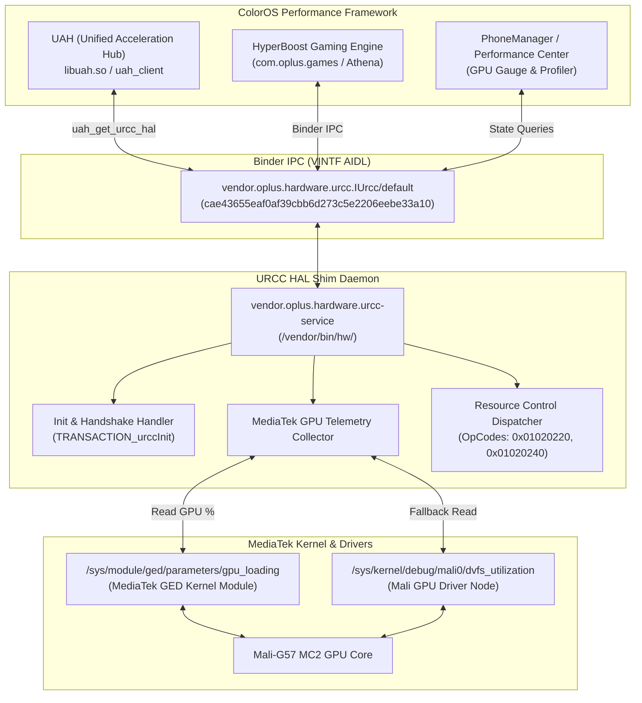

# OPlus URCC AIDL HAL Service for MediaTek Devices

Lightweight implementation of `vendor.oplus.hardware.urcc.IUrcc` (Unified Resource Control Center) designed for ColorOS, OxygenOS, and RealmeUI (Android 14+) ROM ports on MediaTek platforms (Helio G99 / MT6789 and Dimensity SoCs).

---

## Overview

In ColorOS, performance-critical components such as UAH (Unified Acceleration Hub), HyperBoost, Athena, and PhoneManager SuperComputing Engine query the URCC HAL (`vendor.oplus.hardware.urcc.IUrcc/default`) to read GPU load, frame metrics, thermal states, and register resource listeners.

On non-OPlus devices, the absence of this service leads to:
1. Logcat spam from `UAH_CLIENT` (`Urcc HAL Service not found`, `uah_get_urcc_hal_and_link_to_death error:-1`).
2. Broken or missing GPU loading metrics in PhoneManager / Game Assistant.
3. Premature throttling or failed performance profiling in HyperBoost.

This service acts as a native shim daemon that binds to `vendor.oplus.hardware.urcc.IUrcc/default`, satisfies UAH client handshakes, and provides real GPU load metrics directly from MediaTek GED (`/sys/module/ged/parameters/gpu_loading`) and Mali DVFS interfaces.

---

## Architecture Diagram



---

## Configuration & Integration

### 1. Init Configuration (.rc)
File location: `/vendor/odm/etc/init/vendor.oplus.hardware.urcc-service.rc` (or `/vendor/etc/init/`)
Permissions: `0644` (rw-r--r--)

```rc
service vendor.oplus.hardware.urcc-service /vendor/odm/bin/hw/vendor.oplus.hardware.urcc-service
    class hal
    user system
    group system readproc
    interface aidl vendor.oplus.hardware.urcc.IUrcc/default
```

Important security notes:
* Must run under `user system`. Do not set `user root`.
* Do not declare `capabilities SYS_PTRACE`, as modern Android init rejects ptrace capabilities on HAL domains.
* Use canonical path `/vendor/odm/bin/hw/...` rather than symlink `/odm/bin/hw/...`.

---

### 2. VINTF Manifest Fragment
File location: `/vendor/odm/etc/vintf/manifest/manifest_oplus_urcc.xml` (or `/vendor/etc/vintf/manifest/`)
Permissions: `0644` (rw-r--r--)

```xml
<?xml version="1.0" encoding="utf-8"?>
<manifest version="1.0" type="device">
    <hal format="aidl">
        <name>vendor.oplus.hardware.urcc</name>
        <version>1</version>
        <fqname>IUrcc/default</fqname>
    </hal>
</manifest>
```

Place it as an independent XML fragment in the `manifest/` subfolder.

---

### 3. Binary Executable & EROFS Repack Configuration
File location: `/vendor/odm/bin/hw/vendor.oplus.hardware.urcc-service`
Permissions: `0755` (rwxr-xr-x)
SELinux Context: `u:object_r:hal_urcc_default_exec:s0` (or `u:object_r:hal_allocator_default_exec:s0`)

When repacking EROFS with DNA Tool or mkfs.erofs:
* **fs_config**:
```text
vendor/odm/bin/hw/vendor.oplus.hardware.urcc-service 1000 1000 0755
vendor/odm/etc/init/vendor.oplus.hardware.urcc-service.rc 0 0 0644
vendor/odm/etc/vintf/manifest/manifest_oplus_urcc.xml 0 0 0644
```

* **file_contexts**:
```text
/vendor/odm/bin/hw/vendor\.oplus\.hardware\.urcc-service u:object_r:hal_urcc_default_exec:s0
/vendor/odm/etc/init/vendor\.oplus\.hardware\.urcc-service\.rc u:object_r:vendor_configs_file:s0
/vendor/odm/etc/vintf/manifest/manifest_oplus_urcc\.xml u:object_r:vendor_configs_file:s0
```

---

## AIDL Transactions Implemented

| Transaction Code | Method Name | Functionality |
| :--- | :--- | :--- |
| **1** | `urccInit` | Initializes client session and registers DeathRecipient |
| **2** | `urccResCtlRequest` | Resource control requests from HyperBoost |
| **3** | `urccResCtlRelease` | Releases active resource control leases |
| **4** | `urccResStateRequest` | Reports GPU load metrics (OpCodes: `0x01020220`, `0x01020240`) |
| **5** | `urccResListeningRegister` | Registers listeners for resource state change events |
| **6** | `urccResListeningUnRegister` | Unregisters resource listeners |
| **7** | `urccPropertyGet` | Retrieves internal properties |
| **8** | `urccPropertySet` | Sets internal operational parameters |
| **9** | `urccThermalListeningRegister` | Subscribes to thermal framework events |
| **10** | `urccThermalListeningUnRegister`| Unsubscribes from thermal framework events |
| **11** | `uahNotifyExt` | Handles external notifications from UAH client |
| **12** | `setRelatedSysInfo` | Receives system performance state info |
| **13** | `urccRuleCtl` | Handles dynamic rule evaluation |
| **14** | `uahResCtlRequestBypass` | Handles resource control bypass flags |
| **0x00fffffe** | `getInterfaceVersion` | Returns interface version (1) |
| **0x00ffffff** | `getInterfaceHash` | Returns interface hash (`cae43655eaf0af39cbb6d273c5e2206eebe33a10`) |

---

## Build Instructions

### Prerequisites
* Linux host (x86_64).
* Android NDK r26b or newer with Clang targeting `aarch64-linux-android34-clang`.
* Support for 16KB memory page alignment (`-Wl,-z,max-page-size=16384`).

### Build Command
```bash
# Clean previous build artifacts
./build.sh clean

# Compile binary and package releases
./build.sh
```

### Outputs
Compiled artifacts are stored in `out/`:
* `vendor.oplus.hardware.urcc-service`: Stripped ARM64 ELF executable (~9.8 KB).
* `vendor.oplus.hardware.urcc-service.rc`: Android init service configuration.
* `manifest_oplus_urcc.xml`: VINTF manifest XML fragment.
* `urcc_package.zip` / `urcc_package.tar.gz`: Complete pre-packaged deployment archive.
