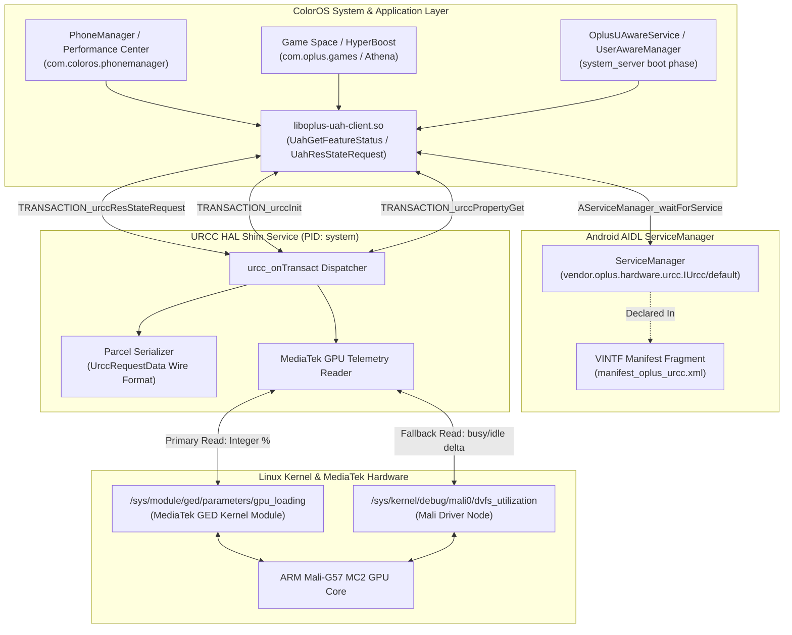
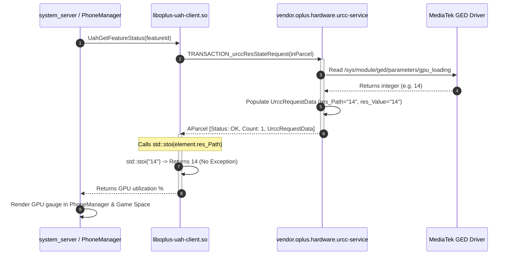

# OPlus URCC AIDL HAL Service for MediaTek Devices

Lightweight implementation of `vendor.oplus.hardware.urcc.IUrcc` (Unified Resource Control Center) engineered for ColorOS, OxygenOS, and RealmeUI (Android 14+) ROM ports on MediaTek platforms (Helio G99 / MT6789 and Dimensity SoCs).

---

## 1. Overview

In ColorOS 14 and 17, the performance framework relies on URCC (`vendor.oplus.hardware.urcc.IUrcc/default`) as the central hardware arbitration interface. Subsystems such as UAH (Unified Acceleration Hub), HyperBoost (`com.oplus.games`), Athena, and PhoneManager SuperComputing Engine query URCC to read real-time GPU utilization, register dynamic performance leases, and capture system resource statistics.

When running ColorOS on ported non-OPlus hardware without a functional URCC daemon:
1. `UAH_CLIENT` spams error logs continuously (`Urcc HAL Service not found`, `uah_get_urcc_hal_and_link_to_death error:-1`).
2. The GPU utilization monitor and performance gauge in PhoneManager and Game Space fail to appear or stay stuck at 0%.
3. System stability mechanisms fail during boot phase handshakes (`reportBootPhase`), causing framework stalls or soft-reboots.

This daemon acts as a drop-in AIDL HAL service that binds to `vendor.oplus.hardware.urcc.IUrcc/default`, implements the required Binder transactions, and bridges GPU loading metrics directly from MediaTek kernel drivers (`/sys/module/ged/parameters/gpu_loading` and Mali DVFS interfaces).

---

## 2. Architecture & Call Flow Diagrams

### System Component Architecture



### IPC Transaction & Execution Flow



---

## 3. Reverse Engineering Insights: Wire Format & `std::stoi` Caveat

During deep disassembly of `/system_ext/lib64/liboplus-uah-client.so`, the disassembly of `UahGetFeatureStatus` revealed a critical architectural requirement:

```text
#08 libc++.so (std::stoi)
#09 liboplus-uah-client.so (UahGetFeatureStatus+600)
#10 libUahPerf_Jni.so (android::get_feature_status)
#11 oplus-framework.jar (UAHPerfManager.getFeatureStatus)
#12 oplus-services.jar (OplusUAwareService.getFeatureStatus)
```

### Disassembly Analysis
```assembly
23e64: ldp   x8, x9, [sp, #0x18]      ; x8 = vector.data(), x9 = vector.end()
23e68: sub   x9, x9, x8               ; Total byte span
23e6c: cmp   x9, #0x68                ; Exactly 1 element (sizeof(UrccRequestData) = 104 bytes)
23e70: b.ne  0x23eac
23e74: ldrb  w9, [x8, #0x20]          ; Check res_Path active flag
23e78: tbz   w9, #0x0, 0x23f64
23e7c: add   x0, x8, #0x8             ; x0 = &vector[0].res_Path (offset +0x8)
23e80: mov   x1, xzr                  ; idx = nullptr
23e84: mov   w2, #0xa                 ; base = 10
23e88: bl    std::__1::stoi           ; std::stoi(vector[0].res_Path)
23e8c: mov   w19, w0                  ; Returned feature value
```

### Root Cause of Previous Soft-Reboots
* `UrccRequestData` layout in C++:
  * Offset `+0x00`: `int32_t res_Id`
  * Offset `+0x04`: `int32_t event_Id`
  * Offset `+0x08`: `std::string res_Path` (24 bytes)
  * Offset `+0x28`: `std::string res_Value` (24 bytes)
  * Offset `+0x48`: `std::string desc` (24 bytes)
* If `res_Path` is written as an empty string `""`, `UahGetFeatureStatus` executes `std::stoi("")`.
* `std::stoi("")` immediately throws an uncaught `std::invalid_argument` exception.
* Because this occurs in `system_server` during boot (`reportBootPhase`), `system_server` terminates, prompting Android `init` to restart Zygote and trigger a loop back to the boot animation (soft-reboot).

### The Solution
In `write_urcc_request_data`, both `res_Path` and `res_Value` are populated simultaneously with the numeric GPU percentage string (or fallback `"0"`). `std::stoi` succeeds, and `system_server` stays completely stable.

---

## 4. Configuration & Deployment

### 1. Init Configuration (.rc)
File destination: `/vendor/odm/etc/init/vendor.oplus.hardware.urcc-service.rc` (or `/vendor/etc/init/`)  
Permissions: `0644` (`rw-r--r--`)  
Owner / Group: `root:root`

```rc
service vendor.oplus.hardware.urcc-service /vendor/odm/bin/hw/vendor.oplus.hardware.urcc-service
    class hal
    user system
    group system readproc
    interface aidl vendor.oplus.hardware.urcc.IUrcc/default
```

Key Requirements:
* Must execute from canonical path `/vendor/odm/bin/hw/...` rather than rootfs symlink `/odm/bin/hw/...`.
* Must run under `user system`.
* Do not declare `capabilities SYS_PTRACE`, as Android 14+ init blocks ptrace capabilities on HAL domains.

---

### 2. VINTF Manifest Fragment
File destination: `/vendor/odm/etc/vintf/manifest/manifest_oplus_urcc.xml` (or `/vendor/etc/vintf/manifest/`)  
Permissions: `0644` (`rw-r--r--`)  
Owner / Group: `root:root`

```xml
<?xml version="1.0" encoding="utf-8"?>
<manifest version="1.0" type="device">
    <hal format="aidl">
        <name>vendor.oplus.hardware.urcc</name>
        <version>1</version>
        <fqname>IUrcc/default</fqname>
    </hal>
</manifest>
```

---

### 3. Binary Executable & EROFS Repack Configuration
File destination: `/vendor/odm/bin/hw/vendor.oplus.hardware.urcc-service`  
Permissions: `0755` (`rwxr-xr-x`)  
SELinux Context: `u:object_r:hal_urcc_default_exec:s0`

When repacking EROFS partitions using DNA Tool or `mkfs.erofs`, configure the following:

#### `fs_config` / `filesystem_config.txt`
```text
vendor/odm/bin/hw/vendor.oplus.hardware.urcc-service 1000 1000 0755
vendor/odm/etc/init/vendor.oplus.hardware.urcc-service.rc 0 0 0644
vendor/odm/etc/vintf/manifest/manifest_oplus_urcc.xml 0 0 0644
```

#### `file_contexts` / `file_contexts.txt`
```text
/vendor/odm/bin/hw/vendor\.oplus\.hardware\.urcc-service u:object_r:hal_urcc_default_exec:s0
/vendor/odm/etc/init/vendor\.oplus\.hardware\.urcc-service\.rc u:object_r:vendor_configs_file:s0
/vendor/odm/etc/vintf/manifest/manifest_oplus_urcc\.xml u:object_r:vendor_configs_file:s0
```

> [!IMPORTANT]
> If the binary is labeled `u:object_r:vendor_file:s0`, Android init will reject execution due to SELinux policy constraints (no transition domain from `init` to `hal_urcc_default`). Assigning `hal_urcc_default_exec:s0` is mandatory for automatic boot startup.

---

## 5. AIDL Interface Reference

Interface Descriptor: `vendor.oplus.hardware.urcc.IUrcc`  
Instance Name: `vendor.oplus.hardware.urcc.IUrcc/default`  
Interface Hash: `cae43655eaf0af39cbb6d273c5e2206eebe33a10`  
Interface Version: `1`

| Code | Method Name | Input | Output | Purpose |
| :--- | :--- | :--- | :--- | :--- |
| **1** | `urccInit` | None | None | Client session establishment and DeathRecipient registration |
| **2** | `urccResCtlRequest` | `UrccRequestParcel` | `int32_t` (0) | HyperBoost dynamic resource lease allocation |
| **3** | `urccResCtlRelease` | `int32_t` (handle) | `int32_t` (0) | HyperBoost resource release |
| **4** | `urccResStateRequest` | `UrccRequestParcel` | `UrccRequestData[]` | Real-time GPU loading report (OpCodes: `0x01020220`, `0x01020240`) |
| **5** | `urccResListeningRegister` | `UrccRequestParcel`, `IUrccCallback` | `int32_t` (0) | Resource threshold change listener registration |
| **6** | `urccResListeningUnRegister` | `int32_t` (handle) | `int32_t` (0) | Unregister listener callback |
| **7** | `urccPropertyGet` | `String` (key) | `String` ("0") | Query internal daemon configuration property |
| **8** | `urccPropertySet` | `String` (key), `String` (val) | `int32_t` (0) | Modify internal daemon operational parameter |
| **9** | `urccThermalListeningRegister`| `int32_t[]` (zones), `IUrccCallback` | `int32_t` (0) | Subscribe to thermal zone notification events |
| **10**| `urccThermalListeningUnRegister` | `int32_t` (handle) | `int32_t` (0) | Unsubscribe from thermal notifications |
| **11**| `uahNotifyExt` | `int32_t`, `int32_t`, `int32_t[]` | `int32_t` (0) | UAH client status notification |
| **12**| `setRelatedSysInfo` | `int32_t`, `byte[]` | `int32_t` (0) | Framework telemetry ingestion |
| **13**| `urccRuleCtl` | `int32_t`, `int32_t`, `UrccRequestData[]` | `int32_t` (0) | Dynamic performance rules evaluation |
| **14**| `uahResCtlRequestBypass` | `UrccRequestParcel` | None | Bypass flag dispatcher |
| **0x00fffffe** | `getInterfaceVersion` | None | `int32_t` (1) | AIDL interface version query |
| **0x00ffffff** | `getInterfaceHash` | None | `String` (hash) | AIDL interface stability hash verification |

---

## 6. Build Instructions

### Prerequisites
* Linux workstation (x86_64).
* Android NDK r26b or newer with Clang (`aarch64-linux-android34-clang`).
* 16KB memory page alignment support (`-Wl,-z,max-page-size=16384`).

### Compilation
```bash
# Clean previous build artifacts
./build.sh clean

# Compile binary, strip symbols, and package outputs
./build.sh
```

### Generated Artifacts
All generated files are placed in `out/`:
* `vendor.oplus.hardware.urcc-service`: Stripped ARM64 ELF executable (~9.9 KB).
* `vendor.oplus.hardware.urcc-service.rc`: Android init service configuration script.
* `manifest_oplus_urcc.xml`: VINTF manifest XML fragment.
* `urcc_package.zip`: Pre-packaged deployment archive.
* `urcc_package.tar.gz`: Pre-packaged tarball archive.

---

## 7. Verification Commands

Once the ROM image is repacked and booted on the device, run the following verification steps:

```bash
# 1. Verify process is running under system user
adb shell "ps -A | grep urcc"
# Expected output:
# system  <PID>  1  ...  vendor.oplus.hardware.urcc-service

# 2. Verify AIDL registration with ServiceManager
adb shell "service list | grep -i urcc"
# Expected output:
# vendor.oplus.hardware.urcc.IUrcc/default: [vendor.oplus.hardware.urcc.IUrcc]

# 3. Verify init service state
adb shell "getprop init.svc.vendor.oplus.hardware.urcc-service"
# Expected output:
# running

# 4. Verify MediaTek kernel GPU reading node
adb shell "cat /sys/module/ged/parameters/gpu_loading"
# Expected output:
# Integer value between 0 and 100
```
